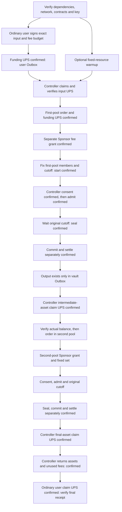

# Actual wait dependencies of the two-pool route

Applies to `adapter.mjs`, `service.mjs` and `acceptance/executeRouteWorker.mjs`.
A UPS writes state owned by one executing account. Multiple vaults/realms require
separately confirmed stages, without global atomic rollback. Confirmation below
requires the exact historical receipt and visibility at a common checkpoint;
an ACK alone is insufficient.

A Sponsor must consume/reconcile its exact preceding grant before another grant;
its nonce is serial. Each shared vault depends on its previous final root. Each
controller step also serializes its own nonce/root. The second pool requires the
actual first fill and a confirmed controller claim: neither quotes nor pending
Outbox outputs are spendable balances.

Stateless circuit resources, identity binding and independent reads may prepare
early. Warmup is explicit opt-in and preserves all checks before/after; future
parallel acceptance must include its full time/memory. Reconcile unknown broadcasts
before new financial work. An ordinary-wallet payment already in flight must
complete or reconcile independently; failed parallel warmup does not undo payment.

Choose members before freezing, within the verified four-member capacity.
Wait/budget estimates do not authorize changing accepted sets or cutoffs. A shorter
window needs available-time checks and failure exits; one successful window is
not a tail-latency guarantee.

Cancellation/expiry before hop one returns actual input. After hop one fills but
hop two does not, return actual intermediate assets and remaining escrow, without
reversing the original price. Admitted orders must reach a lawful market terminal
state and sender-bound recovery before refund claims. The original payer may
request recovery; anyone with proving resources can advance the dedicated policy.
The controller spends user-authorized budget, market Executor spends explicit
Sponsor grants, and ordinary users pay for their claims.

Insufficient budget stops execution, without hidden top-ups. The current one-shot
controller has no arbitrary top-up channel. An unconditional executable exit
cannot be claimed when remaining funds cannot pay for a legal recovery UPS.
Record that condition in sustained-run budgets and stop rules. Any new budget
policy must separately bind payer, cap and purpose and pass validation; do not
weaken the old policy.
