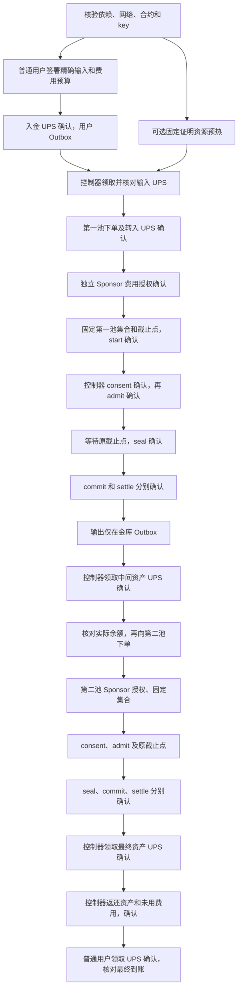

# 双池路线的实际等待依赖

对应 `adapter.mjs` / `service.mjs` / `acceptance/executeRouteWorker.mjs`。单一 UPS 只写一个执行账户拥有的状态；跨金库和跨 realm 是多个独立确认的阶段，没有全局原子回滚。图中的确认必须包括精确历史回执及共同 checkpoint 可见，ACK 本身不够。

同一 Sponsor 的后续 grant 必须等前份精确授权被消费/对账，账户 nonce 串行；共享金库每次依赖其上一笔结束根。controller 的每一步同样按自身 nonce/根串行。第二池输入依赖第一池实际成交和控制器已确认领取，不能把报价或待领取 Outbox 当余额。

可以提前的工作是无状态电路资源、身份绑定和独立只读准备。预热只在明确选择后执行，前后保留全部校验；未来实际并行验收须同时计入预热资源的耗时和内存。前一份广播不明时先对账，不借预热启动另一金融操作。任何在途普通钱包付款都必须独立完成或原样对账，不能因并行的预热失败就当作付款失败。

集合只在冻结前选择；当前容量仍为已验证的四成员上限。等待与预算估计是建议，不授权改变已接受集合或 cutoff。任何缩短选窗都必须验证可用时间并保留失败退出，不把一次满足窗口当作尾延迟保证。

取消/超时在第一跳成交前退出时返还实际输入；第一跳成交、第二跳未成交时返还实际中间资产及剩余 escrow，不逆转原成交价格。已接纳订单必须先经过市场终态和 sender-bound 恢复，再领取返还资产。原付款人可请求取消/恢复，任何拥有证明资源者可按专用策略推进；控制器花费用户预授权预算，市场 Executor 花费显式 Sponsor 授权，普通领取由普通用户付费。

预算不足会停止，不暗中充值。当前 one-shot 控制器没有任意 top-up 通道；已不足以生成合法恢复 UPS 的情形不能声称存在可执行无条件退出，必须在持续验收的启动预算和停止条件中单列。新策略若需追加预算，须另行绑定付款人/上限/用途并验证，不能放松旧策略。
