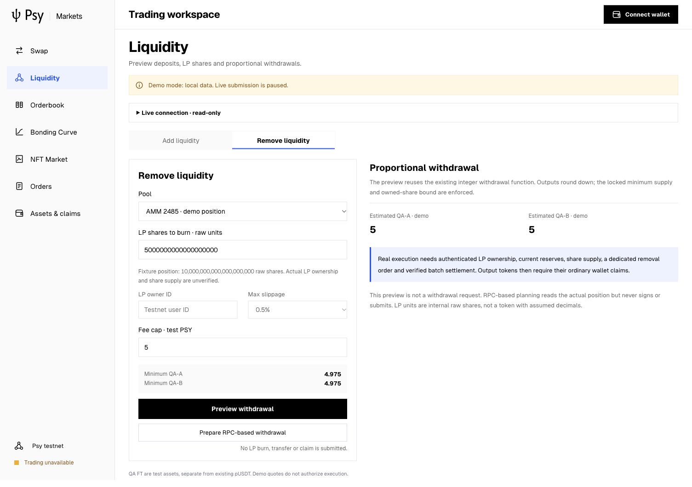
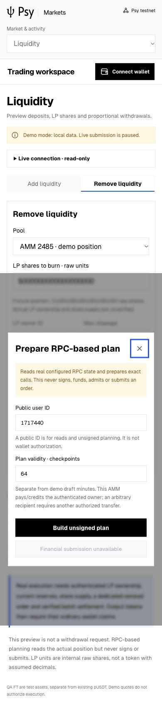

# AMM observed account and unsigned recovery planning

## Delivered boundary

This milestone extends the existing public market client, read-only gateway and
unified dApp. It does not implement a signing wallet, enable financial writes,
change a deployed contract/key, or switch the selected SDK. The original UI task
was temporarily displaced by a scheduled RPC check, then resumed without killing
its Vite/gateway processes or discarding changes.

- Schema-2 common-checkpoint observations include native output cursors, actual
  LP ownership and vault consumption/recovery/batch state. Old snapshot schemas
  and contradictory cursors reject. RPC observations are not state proofs.
- The Assets/Orders account section separates exact wallet balances, pending
  vault outputs and unused incoming deposits. LP uses raw internal units.
  Consumed is labelled processed, without claiming a fill or refund. Admission
  consent is not accepted queue membership. Stale observations cannot plan.
- Withdrawal planning uses actual owned LP, both downward-rounded minimum outputs
  and market fee escrow, without depositing FT. Claim planning covers selected
  FT and native vault outputs. Cancellation, lawful release, recovery enrollment
  and closure retain their consent/epoch rules and original-payer destination.
  Recovery enrollment moves no funds; the restricted Executor still needs fees
  and execution, followed by an ordinary wallet claim.
- A versioned registry adds four existing descriptors from the unchanged frozen
  ABIs. The old registry is untouched. Both browser and gateway pin canonical hash
  `d1b7222f99aea7313b72f76aa21a4d43c25f35df96e7a640c27f5fbadb220423`.

Sources: [projection](../../../market-client/accountProjection.mjs),
[planner](../../../market-client/ammPlan.mjs),
[account UI](../../../dapp/src/markets/ObservedAccount.tsx),
[gateway](../../gateway/adapter.mjs),
[runbook and exact-wallet requirements](../../../market-client/README.md).

## Verification and environment

Existing Node.js 24.19.0, React 18.3.1, Vite 8.3.5; no dependency migration.
`node --test market-client/*.test.mjs executor/gateway/*.test.mjs`: 38 pass,
zero failed/skipped. Frontend `test:markets`: 36 pass, zero failed/skipped.
Production TypeScript/Vite build passes. The initial three planner failures
(undeclared existing methods) remain in the original log; the corrected registry
extension, rather than a relaxed allowlist, fixes them.

Existing IAB at http://127.0.0.1:5273, desktop 1505x1045 and mobile 390x844:
10 checks pass; no console warnings/errors, framework overlay or document
horizontal overflow. Tested invalid user/expiry, actual RPC outage, unsigned
withdrawal, disabled financial submission, Escape/focus recovery, mobile modal,
and separation of local demo claims. Browser plugin was unavailable; the
existing IAB binding through cua Playwright continued after the earlier Ego
continuity blocker. No raw Playwright process, network mock, browser fixture
injection or financial browser action was used.

All 1,466 selected SDK source hashes match manifest
`0afb4c65116cddcaca450b406a06503d65b63d38a004d8e773c6e5fa363bd425`.
All 15 unchanged registry inputs match; new descriptors match the frozen ABI.
Official logo hash remains unchanged. No Node or old-contract work occurred.

## Actual observations and unresolved acceptance

The real snapshot and unsigned withdrawal-plan requests exhausted the existing
bounded read retries and returned HTTP 503. The UI reports unavailability, clears
unusable observations and never substitutes demo balances. The separate readonly
14:24 UTC heartbeat also observed realm 0, realm 1 and coordinator HTTP 503.
No financial request, deployment, proof, payment, fill, network fee or claim was
submitted by this milestone. There is no throughput or performance result.

Healthy snapshot rendering and actual on-chain withdrawal/recovery/ordinary
claims remain unaccepted. Projection and HTTP fixture tests cover synthetic
healthy states only; they do not establish healthy RPC or complete UPS security.
The browser wallet still lacks the accepted exact prepare/verify/one-shot
broadcast/original reconcile integration described in the runbook. Direct
sign-and-send is not a fallback. Executor status/control is not attached.
Runtime identity and existing authorization boundaries remain open.

The original two-pool real settlement/claim/performance plan, bounded local
continuous-fault acceptance and independent Book-to-AMM workflow remain pending.
Closing this UI lease only restores the existing heartbeat's ability to attempt
that plan after RPC recovery and the complete fresh preflight.

## Evidence

[Archive manifest](archive/manifest.json) retains public observations, source
hashes, browser checks, build/regression logs, failure logs and an immutable prefix
of the running read-only gateway log. It excludes the mutable log, unsigned plan
store and all wallet material. Screenshots have separate hashes in the archive.
Original files are in persistent `psy-market-recovery-20261023/market-ui-amm-account-20261026-v1`.

