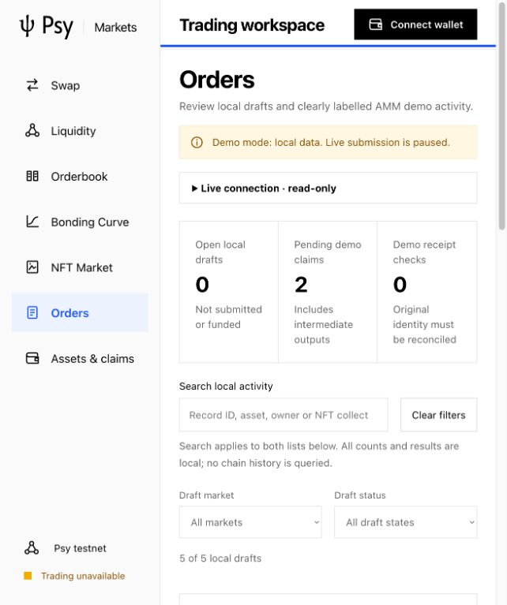
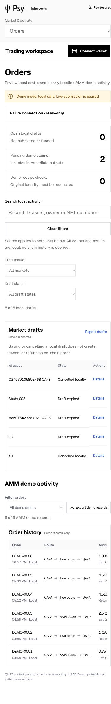

# Local market activity UX acceptance

The user explicitly requested stopping the RPC timer and focusing on the UI.
The app automation tool deleted heartbeat `rpc`; no replacement automation was
created. Existing financial plans and unknown-request identities were not changed.

## User-visible changes

- Orders has shared local search by ID, original demo request identity,
  asset, owner/recipient and NFT collection/token reference. Draft market/status
  filters and AMM state filters are separate, with result counts, reset and
  useful empty states. Summary counts include all local records, not search
  matches or chain data. The readonly RPC disclosure defaults to collapsed.
- Pending intermediate outputs, final claims and refunds are not in-progress or
  completed. Unknown original receipts remain a distinct category. Filtering
  never executes, retries, reconciles or changes any financial operation.
- Assets now includes pending intermediate demo outputs in the actual middle
  asset and quantity. A simulated intermediate claim removes only that pending
  entry; no final output or spendable chain balance is invented. The pending
  aggregation is computed once per render, using exact BigInt values.
- Draft details show ID, current local cancellation/expiry, owner, exact amounts
  and expiry. Original data remains behind disclosure. Open market navigation
  does not reactivate a draft or carry an expired quote into a financial path.
- A local expiry timer and focus/visibility refresh keep labels current without
  rewriting records. Titles, main focus and scroll follow navigation, including
  returning to the same market from a dialog. Back closes out-of-context
  dialogs while preserving in-session filters; full reload resets filters but
  retains validated saved records. Mobile summary rows and filters fit the page.

Sources: [activity model](../../../dapp/src/markets/activity.mjs),
[clock](../../../dapp/src/hooks/useDraftClock.ts),
[details](../../../dapp/src/markets/ProductCommon.tsx),
[assets](../../../dapp/src/markets/AssetsPanel.tsx),
[app](../../../dapp/src/App.tsx),
[regression](../../../dapp/tests/activity.test.mjs).

## QA environment and results

Existing Node.js 24.19.0, React 18.3.1, Vite 8.3.5 and selected SDK unchanged.
Production TypeScript/Vite build passes. `npm run test:markets --prefix dapp`:
41 pass, zero failed/skipped, including five new classification/search/expiry/
immutability/intermediate-asset regressions. Final build/test v3 supersedes v1/v2
only for final-source coverage; all original successful logs are retained.
English and frozen-original checks also pass.

Browser plugin was unavailable. Existing IAB at http://127.0.0.1:5273 continued
through cua Playwright after the earlier recorded Ego continuity blocker; no new
browser dependency, raw Playwright process or injected browser state was used.
Desktop 1505x1045 and mobile 390x844: 21 checks pass, no relevant console
warnings/errors, framework overlay or document horizontal overflow. Intentional
inner table scrolling remains available. Tested:

- Search across both lists; combined NFT collection/token/market/expired filter;
  reset, counts and clear empty-state recovery.
- Exact amounts and current state in details; Open market and Back focus/scroll,
  including same-market return and Escape focus restoration.
- New UI-DRAFT-0005 for local owner 12346: preview/save, search, cancel and reload;
  all prior local records remain. This new record remains cancelled locally.
- New DEMO-0006 for local recipient 12346: explicit local two-pool simulation to
  intermediate Outbox, correct QA-B pending entry and removal after its simulated
  claim. It remains an in-progress local demo after the intermediate claim, not
  a submitted financial operation.
- Mobile navigation for AMM, Book, Curve, NFT and Orders; native search/filter
  controls, detail modal bounds and summary layout.

The v1 browser evidence has 20 checks; v2 adds the same-market return regression
for the final total of 21. Expiry boundary/cancellation precedence and unknown
receipt classification use deterministic model tests. The browser used actual
already-expired local records, without shortening a deadline or injecting a
clock. This is not a full screen-reader or every-browser accessibility audit.

## Evidence and safety boundary

[Archive manifest](archive/manifest.json) binds original logs, public run plan,
all browser observations, source/build hashes and screenshot hashes. Original
screenshots remain outside the repo; selected desktop/mobile images are copied
unchanged here. No private keys, wallet recovery material or mutable financial
journal is included. Old evidence is not overwritten.

No RPC read, registration, deployment, chain financial operation, actual wallet
claim, full UPS generation or financial performance measurement occurred. No
Node, SDK, key, deployed-contract or market pricing/matching semantics changed.
This is local UX acceptance. RPC availability, accepted exact-wallet proof/
verify/broadcast/reconcile transport, actual settlement/claim and production
security conclusions remain open. The deleted heartbeat will not resume them.

