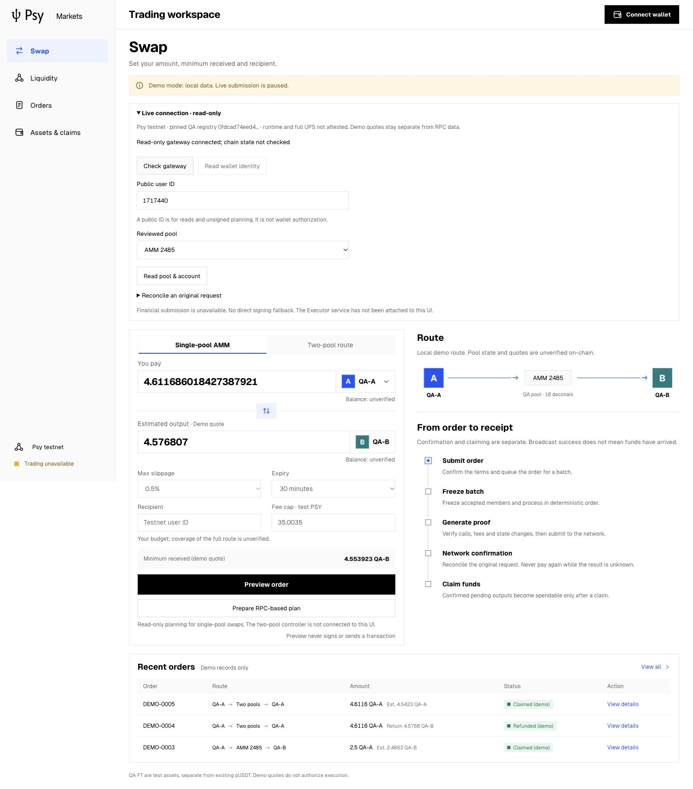
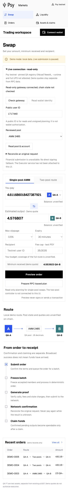
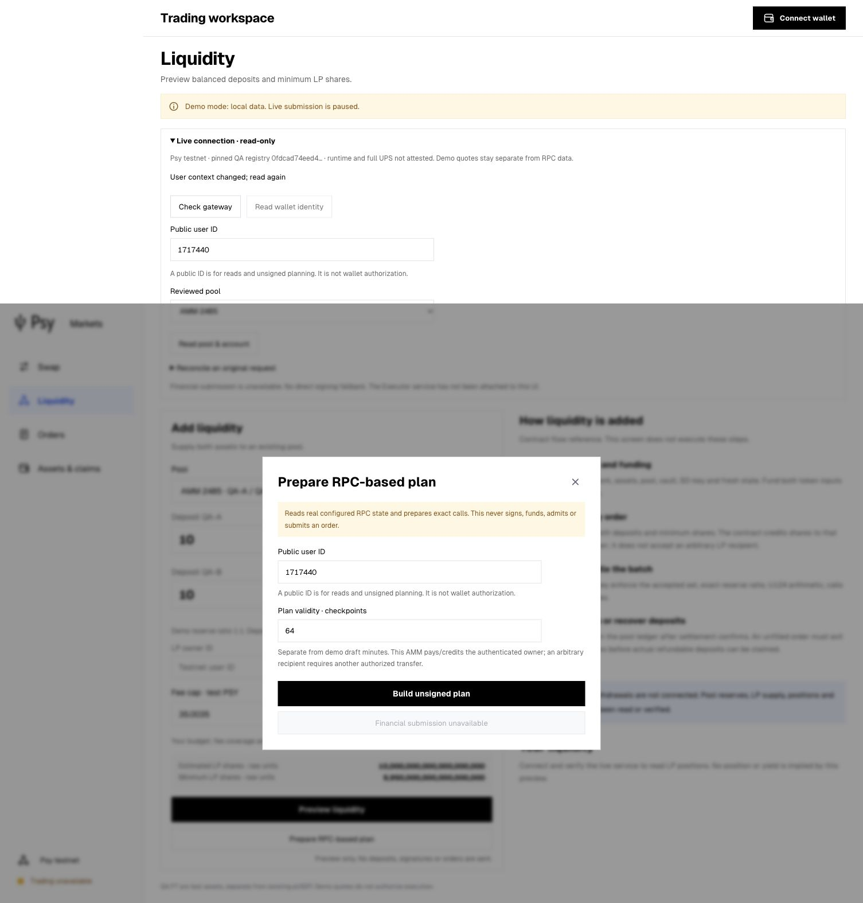

# Public market gateway and exact-wallet integration boundary

**Working now:** existing dapp → same-origin local gateway → reviewed public RPC
reader; exact unsigned AMM planning and original-receipt read interfaces. The
actual network remains unavailable, so no live snapshot/plan/proof is accepted.
**Financial submission remains disabled.** This is not a complete wallet/Executor
financial integration or on-chain acceptance.

[Source, run commands and required wallet interfaces](../../../market-client/README.md).
[Gateway](../../gateway/server.mjs), [reader adapter](../../gateway/adapter.mjs),
[AMM planner](../../../market-client/ammPlan.mjs),
[future exact-user journal seam](../../gateway/workflow.mjs).

## Implemented and checked

- Frozen QA registry for AMMs 2485/2486, FTs 2483/2484, registered vault/key,
  full code/layout/function metadata and exact ABI/policy/config bytes. Browser
  pins the registry and independently recomputes planned calls and quantities.
- Real fixed-checkpoint RPC/Outbox/LP reads using existing Executor readers;
  balances, claimable outputs and internal LP units remain separate. SDK source
  manifest 0afb4c65…bd425 and 1,466 consumed source hashes are unchanged.
- Swap/add plans use existing U124 arithmetic and exact ABI arity (3/4 ordinary
  calls before automatic fee burn); these call counts are **unsigned plan counts**,
  not new full-UPS capacity/proof acceptance. Consent, cancellation request, close
  and selected-token claim are also planned under explicit state checks.
- No new deposit over an unresolved order/consent/Outbox/fee cursor. No arbitrary
  LP/swap recipient: existing contract credits the authenticated owner. Expiry is
  explicitly checkpoints, not a conversion from demo minutes. Actual network fee
  is unknown until verified; market escrow is separate from the owner fee cap.
- Shared browser panel reads gateway status, public wallet metadata, pool/account
  observations and exact original receipts. Account/context edits discard old
  responses. Existing demo store/quotes are never converted into live records.
- Loopback Host/Origin checks, input-size and concurrency bounds, no arbitrary
  proxy/path/Executor control. Gateway upstream transport rejects redirects,
  >1 MiB bodies and wrong RPC IDs, preserving original integer text. The shared
  application `publicState` has an explicit optional transport; existing callers
  retain their default. Psy Node and SDK code are not changed.
- Future exact-user workflow reuses ExecutionJournal/executeCycle. Full stack
  includes automatic burn; fee, owner/key/SDK, nonce, state, expiry, session and
  sig_hash are checked and require an independent verifier callback. Unknown ACK
  survives restart and blocks another proof/payment. Receipt completion also
  waits for common-state nonce/endpoint visibility. Same-payer local locks cover
  same-machine contention; no cross-machine claim is made. This seam is not an
  HTTP route and has **no production browser transport**.

## Verification and retained failures

Final source: production UI build passes; **247 shared-client/gateway/formal
Executor regressions pass, 0 fail/skip**, including 27 gateway/client tests.
**22 frontend regressions pass**, 0 fail/skip. Counts overlap and are not a security
or production conclusion. `test:gateway` is available from the dapp package.

The original test failure reproduction is retained: Node fetch did not transmit
an overridden Host as the test assumed; a raw HTTP test now proves rejection of
an actual hostile Host. Another retained failure exposed a real bug in the new,
unpublished transport seam: a prepared call array shared an object with the
expected plan. All transport boundaries now receive independent copies; parameter,
fee, nonce, state, session/sig_hash and registry mutation cases reject before
sending. Persisted plans are recomputed against their request/snapshot.

Browser environment: IAB 1505×1045 desktop and 390×844 mobile; prior Ego capture
failure/IAB fallback remains in the preceding UI report. Nine checks pass: actual
local gateway connection, handled real RPC failure with no demo fallback, explicit
checkpoint expiry and disabled financial action, stale-context response discard,
local invalid-owner rejection, dialog keyboard containment, multi-UPS route gate,
English desktop and mobile layout/no document overflow. No captured console
warning/error or Vite overlay. The browser wallet is absent, so real wallet
metadata and all financial operations remain unverified.

Actual browser sequence: Check gateway → public QA user 1717440 → read pool/account
→ network unavailable; open RPC-plan dialog → one plan read → change context to
12345 before completion → old response ignored; invalid ID 0 → local error;
Escape → two-pool route → single-pool planner disabled. There were two bounded
network-read surfaces, no original receipt query, new deployment, signing,
proof generation, funding, admission, settlement or claim. Gateway status HTTP 200
only establishes local service availability; it does not establish chain health.
The final server uses the existing Node.js 24.19.0 runtime and remains loopback.

`manifest.json` binds 26 exact originals, including first/final logs, failure
reproductions, initial and superseding postflight, wallet-source interface audit,
actual HTTP status bodies and original source hashes. POSTFLIGHT-v2 supersedes v1
for final bounded-fetch changes: 83 input/static-closure files, production output
hashes, zero accepted live snapshots/plans/UPS and unchanged SDK. Active server
logs are archived as explicit immutable prefix snapshots. Screenshot hashes are
separate. All original comparisons pass; QA-secret value scanning reports no
matches and no wallet files included.

## Open boundaries

The inspected wallet exposes direct sign/send and simulation but not an accepted
exact prepare/verify/one-shot-submit/original-reconcile interface with frozen SDK,
key, full stack/session and fee evidence. BuildId/debug strings are insufficient.
The proposed delivery/acceptance contract is explicit in the source README;
no unsupported provider method is invoked or direct-sign fallback used.

RPC observations are not cryptographic state proofs. Running chain images and
upgrade authorization remain unverified. No healthy-network plan, real ordinary
full UPS, browser settlement, LP deposit/removal, refund or claim was accepted.
Full unaccepted-order recovery enrollment/funding seeds and a reviewed Executor
status projection are pending. Two-pool controller, sustained financial runs and
Book→AMM remain in their prior independent workflow. Book, Curve and NFT UI do
not become functional through this milestone. No throughput, cold/warm financial
performance, memory reduction or production-grade conclusion is supported here.

## Screenshots

