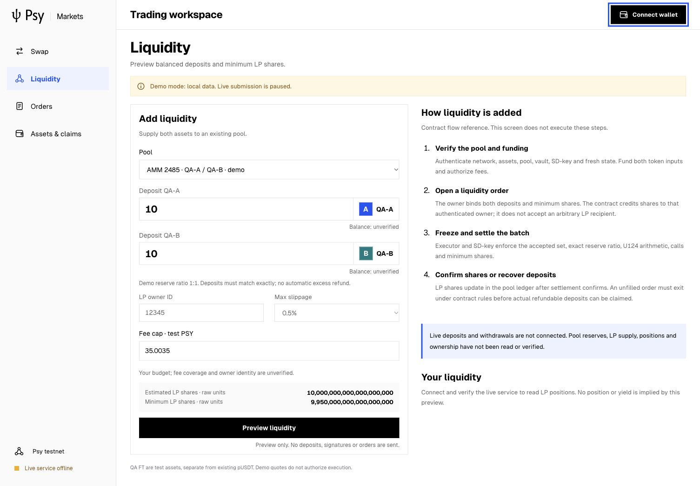
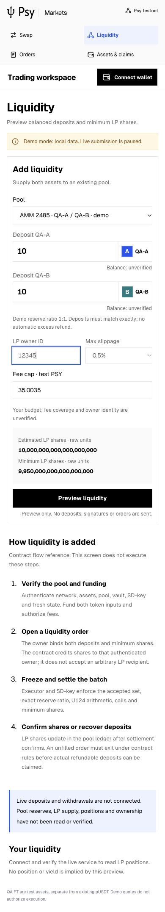
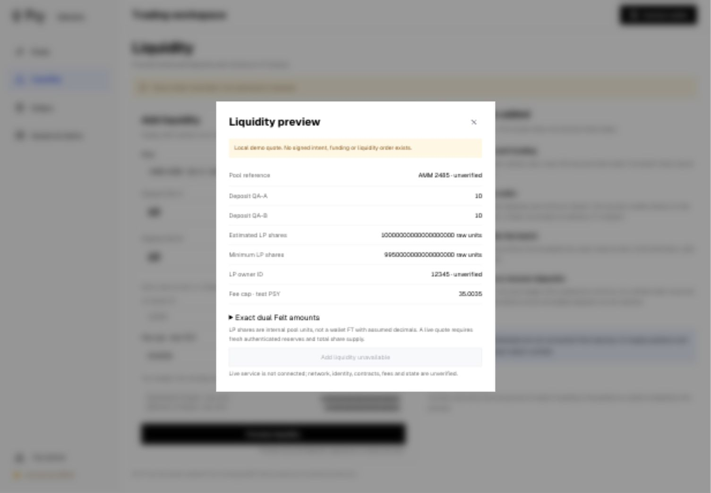

# Liquidity UI and Psy testnet casing

The network label is now **Psy testnet**; the currency ticker remains PSY.
The existing dapp sidebar now has **Liquidity → Add liquidity**. It uses the same
canonical Psy assets, English and editorial theme as the current workbench.

This is an **offline preview**, not usable live funding or LP management. The
client supports exact-ratio `addShares`, and the contract has `open_add` /
`add_liquidity` / refund/close paths; this UI does not yet call them. It must not
imply a verified pool, LP position, fee authorization or successful transaction.

Preview inputs: existing demo pool reference (2485/2486), QA-A and QA-B amounts,
LP owner ID, minimum-share slippage and fee cap in test PSY. Both token amounts
use full U124/dual Felt precision. Existing `addShares` validates exact equal-ratio
deposits, reserve/share overflow and integer minting. No min-based ratio approximation
or automatic excess refund is invented. Fixtures are explicitly 1:1 reserves
and fixed share supply; empty-pool creation is not supported here. LP shares are
**raw internal pool units**, not an FT with assumed decimals. The owner is not an
arbitrary recipient: a future live path must bind it to the authenticated caller.
No fake liquidity order is added to the swap journal or local demo order store.

## QA

URL: http://127.0.0.1:5273/#liquidity. IAB desktop 1505×1045 and mobile 390×844;
prior Ego capture failure and IAB fallback remain documented in the preceding
UI archive. Production TypeScript/Vite build succeeds; **22 regressions pass,
0 fail, 0 skip**. Browser console has no captured warnings/errors.

| Check | Result |
| --- | --- |
| Identity / meaningful screen / no framework overlay | Pass: Liquidity heading and actual form render |
| Casing / English | Pass: Psy testnet, English labels, validation and preview |
| Input validation | Pass: missing owner and unequal deposits reject |
| Exact arithmetic | Pass: 10+10 deposits preview 10000000000000000000 raw shares, minimum 9950000000000000000 |
| Pool selector | Pass: selecting 2486 updates the preview reference |
| Disabled live action | Pass: Add liquidity unavailable remains disabled |
| Keyboard | Pass: backward focus stays inside dialog; Escape closes |
| Mobile | Pass: four-item grid navigation, grouped/stacked raw share quantities, no document overflow |
| Console / screenshot inspection | Pass: desktop and mobile current images reviewed |

Interaction: sidebar Liquidity → preview with missing owner → English error →
enter demo owner 12345 → unequal QA-B amount → exact-ratio error → balance inputs
→ preview → disabled live submit → keyboard close → select second pool → preview.
No wallet sign/send, deposit, LP mint, refund, withdrawal or RPC financial task was
performed. The live gateway remains closed. LP balances/positions, authenticated
fresh pool state and actual deposit/remove/claim integration are still missing;
RPC recovery alone will not connect this frontend service automatically.

Four exact original records are gzip-archived with source/input/output hashes and
all 22 regression results. Original screenshot iterations are retained separately
with hashes; v2 improves grouped raw LP unit readability on mobile. No selected
chain SDK, market contract or Psy Node code is changed. Known-QA-secret scanning
found no matches; no wallet recovery files are included.

Commands: `npm run build`; `npm run test:markets`; compact archive verification.
This is frontend behavior evidence, not complete UPS, chain settlement, performance,
LP economic acceptance or a production-grade conclusion.

