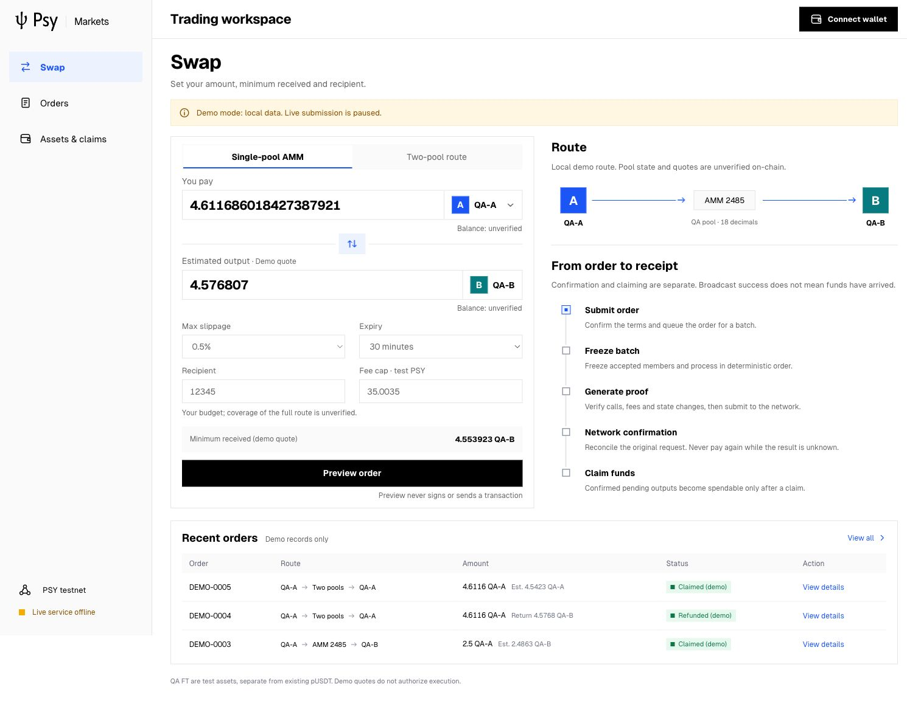
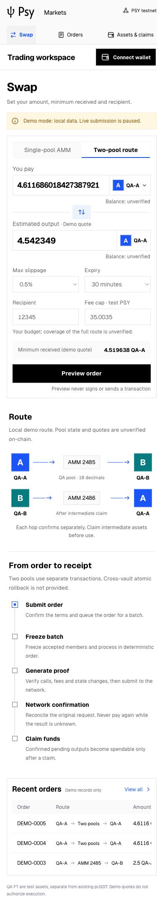
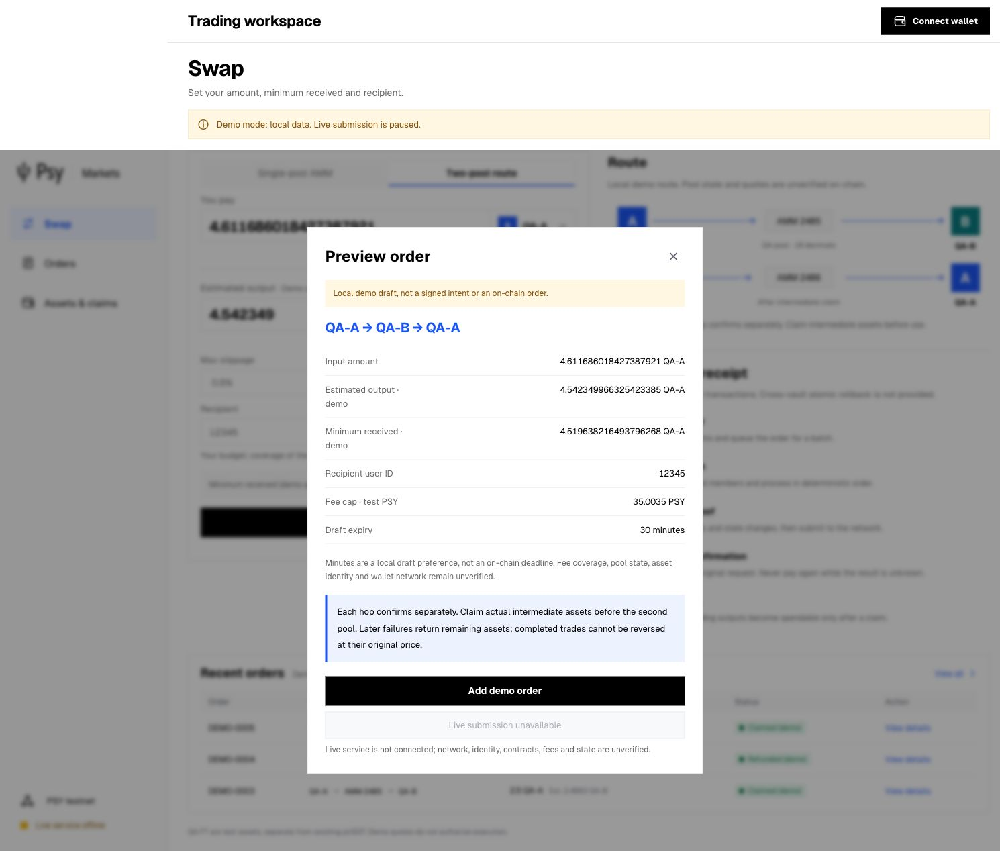
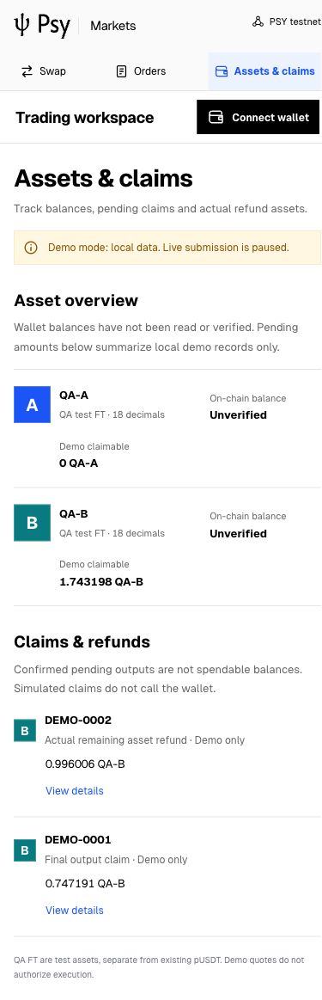

# Psy Markets UI: official identity, English and shared product style

The user requested the existing psy-dapp brand resources, English throughout,
and consistent styling. The current UI uses its actual **psy-editorial** product
theme: white paper, black ink, cobalt #1b55f5, neutral rules, square controls and
local Geist. It does not use the older dark global theme or the rejected purple
concept. Official SVG wordmark, favicon and fonts are copied unchanged; their
source paths and hashes are in [brand provenance](../../../dapp/design/2026-10-26/BRAND-PROVENANCE-v2.json).
Only the canonical token block is reused, excluding unrelated product selectors.

The current app includes single-pool AMM and existing two-pool unsigned previews,
an order center, exact U124 quantities, local progress/claim/refund simulation,
original-request reconciliation, JSON export and persisted demo records. Middle
Outbox cannot fund the second hop until the explicit simulated claim. Partial
recovery returns actual intermediate assets. All active copy, validation, status,
metadata, accessible names and recovery terms are English. The network label is
PSY testnet, with actual identity and balances explicitly unverified.

## Verification

Environment: http://127.0.0.1:5273; IAB desktop 1505×1045 and mobile 390×844.
Ego capture timed out twice during initial QA; IAB was used for rendered validation.
The UI uses the existing Node.js 24.19.0 runtime, npm 9.5.1, React 18.3.1,
Vite 8.3.5, plugin-react 6.1.2 and TypeScript 5.6.3. The lockfile is frozen and
an offline `npm ci --ignore-scripts` reproduction is in v1. This frontend
toolchain is distinct from Psy Node and the selected chain SDK.

| Check | Result |
| --- | --- |
| Page identity / meaningful content / no framework overlay | Pass: Psy Markets · Trading workspace; rendered Swap, Orders and Assets |
| Official logo / local font / shared theme | Pass: loaded SVG, Geist, black ink, cobalt token and square button |
| English-only active code and rendered surfaces | Pass: metadata, form error, preview, order stages, recovery and assets |
| Interaction | Pass: missing recipient → English error; two-pool preview → exact 18-decimal output and disabled live action |
| Dialog | Pass: Shift+Tab remains inside; Escape closes |
| Recovery copy | Pass: existing partial-fill demo describes returning actual QA-B |
| Responsive layout | Pass: no document overflow at 390px on Swap and Assets; order table has contained horizontal scrolling |
| Console / production build | Pass: no captured warnings/errors; TypeScript and Vite build succeed |
| Regressions / dependency audit | 17 passed, 0 failed, 0 skipped; 0 known audit vulnerabilities |
| SDK source integrity | 1,466 frozen source hashes match; no selected chain dependency switch |

Commands: `npm run build`, then `npm run test:markets`, then `npm audit --json`.
Browser loop: reload → missing recipient → error → enter demo recipient 12345 →
Two-pool route → Preview order → disabled live action → keyboard close → Orders →
partial recovery details → Assets → mobile → desktop. No new chain action occurs.

This archive binds 7 exact public originals; the input manifest binds 35 local
app/build/test/asset inputs, and postflight binds the production output. Gzip
records were compared to originals. Four current screenshots have separate
hashes. `PRIVACY-SCAN-v2.json` records a decompressed known-QA-secret scan across
both UI archives and app source/assets: no matches. No wallet files are included.
The initial wrong-brand/Chinese artifacts remain untouched in v1 as superseded
history. Current design decisions are in [DESIGN.md](../../../dapp/design/2026-10-26/DESIGN.md).

## Boundaries

Live trading remains unconditionally disabled. No real wallet connection,
registration, signing, proof, transfer, cancellation, claim or financial receipt
was verified by this UI task. Wallet connection cannot enable trading. Demo
quotes/reserves/IDs/states are not chain evidence. Local storage is not a
financial journal or a cross-machine coordinator. Minutes are draft preferences,
not authenticated checkpoint expiry. Running chain versions are not attested.
This does not close the pending RPC-dependent two-pool, sustained-run or Book→AMM
acceptance and does not imply production-grade security or settlement performance.

## Screenshots

