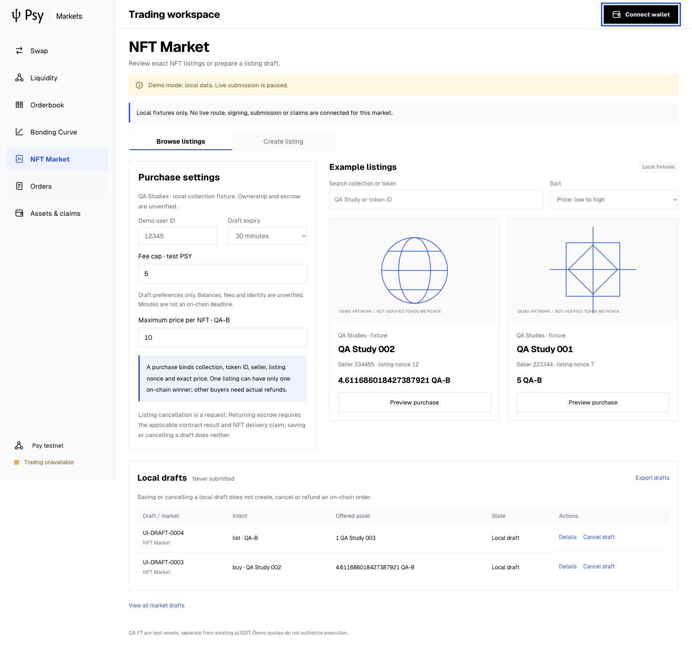
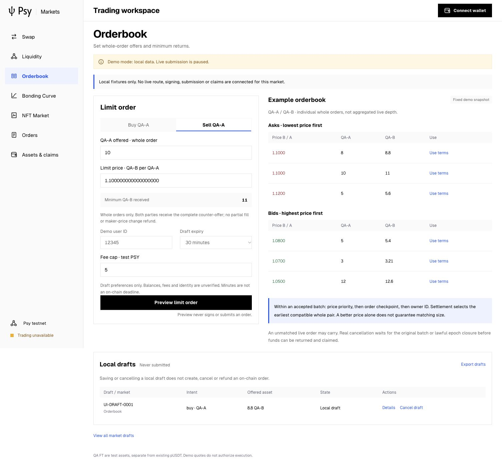
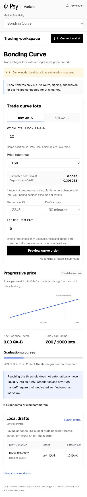

# Three market UI completion · 2026-10-26

Existing branch `markets-batch-capacity-recovery-20261020`; base `75b125af`.
This milestone is frontend/local-draft functionality only. No live financial
request, proof, settlement, LP burn, receipt or wallet claim was produced.

## Implemented

- [Orderbook](../../../dapp/src/markets/OrderbookPanel.tsx): buy/sell whole-order
  offers, fixture price/checkpoint/owner priority and exact offer/minimum preview.
  Full counter-offers are exchanged: no partial fills or maker-price change refund.
- [Bonding Curve](../../../dapp/src/markets/CurvePanel.tsx): integer-lot buy/sell,
  existing quote arithmetic, upward buy cap/downward sell minimum, bounded demo
  position/cap, pricing-function chart and separate graduation boundary.
- [NFT Market](../../../dapp/src/markets/NftMarketPanel.tsx): search, price sort,
  exact fixture collection/token/metadata/seller/listing-nonce/price purchase
  preview and owned-fixture listing draft. Saving a listing does not publish it.
- [Shared module](../../../dapp/src/markets/productDrafts.mjs) and
  [store](../../../dapp/src/hooks/useProductDrafts.ts): canonical recomputation,
  U124 BigInt/two-Felt values, immutable previews, bounded persistence, export,
  details, market filtering and local cancellation. No chain status invented.
- [AMM removal](../../../dapp/src/markets/RemoveLiquidityPanel.tsx): existing
  withdraw arithmetic, raw LP shares, owned-share and locked-supply constraints,
  proportional outputs/minimums and separate ordinary-claim requirement.
- Canonical Psy logo/fonts/style, English copy, seven desktop routes, native
  mobile navigation, Back/deep-link and keyboard/modal behavior.

## Verification and provenance

Production build and **36 frontend tests pass**, no skipped/failed tests. This
includes 14 new arithmetic/persistence/identity/withdrawal tests; it is not a
full UPS/security/financial performance assertion. Existing 22 tests remain.

IAB desktop 1505×1045, mobile 390×844 and modal 375×812 verify forms, exact
amounts, errors, NFT duplicate rejection/wrong owner, local persistence/cancel,
router Back/deep link, skip link, keyboard trap and contained table overflow.
The initial log retains two assertion failures: multiline JSON did not contain
a single-line substring; validation says “belongs to demo user”, not “owner”.
Both actual DOM checks pass under explicit superseding assertions. No console
warnings/errors observed. Ego was unavailable in the earlier browser setup;
existing IAB handle was retained for this local QA. No wallet or financial mocks.

`manifest.json` binds 12 exact public originals: first/final QA, build/test logs,
UI work declaration, design search, pre/postflight, privacy and screenshot hashes.
All archived records compare byte-for-byte with the durable originals. Initial
postflight retains 77 inputs; final v2 includes the documentation closure (78).
1,466 fixed chain SDK source hashes match; SDK manifest remains
`0afb4c65116cddcaca450b406a06503d65b63d38a004d8e773c6e5fa363bd425`.
Frontend dependency lock, Node code and SDK were not changed. Known QA key-value
scan reports zero matches; no wallet recovery files are included. Screenshot
hashes are separate; original screenshots retained, including superseding v2.

## Run and remaining gaps

Use the existing Node.js 24 runtime with `npm run dev --prefix dapp`, then
`http://127.0.0.1:5273/#orderbook`, `#curve`, `#nft`, or `#liquidity`.
`npm run build --prefix dapp` and `npm run test:markets --prefix dapp` reproduce
frontend checks. The existing readonly gateway remains a separate AMM surface.

New-market data is **local-fixture**, financial authorization false, network
unverified-demo. Contract/vault/key identity is not assigned. No live new-market
read gateway, exact wallet prepare/verify/one-shot broadcast/reconcile adapter,
Executor status projection, funding, cancellation/refund or claim path is wired.
Minutes are local preferences, not checkpoint deadlines. Browser storage is
untrusted local data and has no financial or cross-tab coordination guarantee.
Real LP removal also remains unconnected. RPC recovery does not enable writes.

Prior dual-pool live/performance, sustained local fault acceptance and Book→AMM
remain in the original separate plan. UI build time/interaction response is not
proof time, chain TPS or financial end-to-end latency. No production conclusion.

