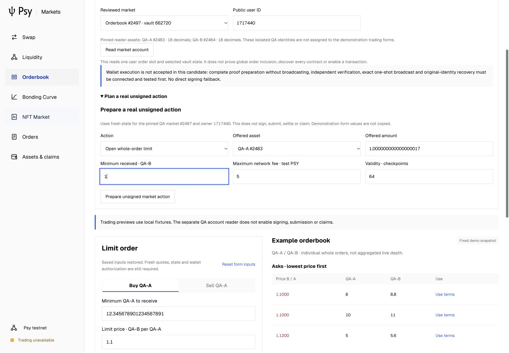
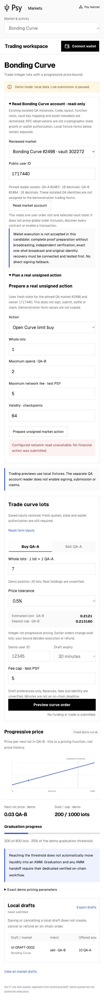

# Three-market unsigned action planning and exact Executor adapter

2026-10-27. Branch: `markets-batch-capacity-recovery-20261020`.
Base: `b4c4668733ffe5d828b1fc5255fed176e7268241`.

## Result and limits

Implemented a formal public unsigned planning route, independent browser plan
reconstruction, UI controls and an ordinary-user three-market Executor adapter.
This is running planning code, not a document-only proposal. It does **not** close
live financial acceptance. The public gateway never signs, proves or broadcasts,
and does not instantiate the financial adapter. No wallet source, SDK, Node,
old contract, random ordering, pricing/matching or permissions were changed.
No financial task or heartbeat was restarted.

Actual endpoint diagnostics still return HTTP 503 for realm0, realm1 and coordinator.
Two actual browser unsigned-plan requests (Book and Curve) also returned HTTP 503.
No healthy plan, cryptographic state proof, native complete UPS, registration,
settlement, fill, ordinary wallet claim/refund or actual fee was accepted here.
All financial operation, proof, fee, fill and claim counts in this run are zero.

## Implemented behavior

- Strict typed-by-kind requests bind reviewed network/SDK registry, owner as final
  recipient, explicit native fee cap and 1..128-checkpoint validity. Terms are
  separate from fixture forms and minute-based draft expiry.
- Book plans use existing whole-order offered/minimum amounts. No partial fill,
  price mechanism or priority change. Curve plans use existing progressive-price
  limit methods, explicit maximum buy input/minimum sell output and whole lots.
- NFT listing binds the observed owned slot, collection, token, metadata, price and
  FIFO sequence. Buying reads both users through one common-checkpoint session,
  verifies listing nonce/price/expiry/cancel/consumed state and **actual** seller
  NFT packet/FIFO and fee escrow. Missing escrow rejects before a funding plan.
- Consent, cancellation, lawful release, sender-bound recovery enrollment, closure
  and FT/native/NFT claims have distinct state requirements. Cancellation never
  removes frozen membership or immediately refunds. Recovery enrollment moves no
  funds; a restricted Executor return and ordinary claim remain separate.
- Complete U124 values, minimum raw units and both maximum limbs are checked.
  New FT/native fee cursors and claim balances cannot overflow; prior unclaimed
  fees/deposits/consent/recovery block new funding. NFT claims use only the next
  pending FIFO item and an observed empty destination, never a demonstration NFT.
- `marketActionClient.mjs` checks registry and canonical-newline ABI hashes,
  recomputes every call, method ID, parameter, debit, endpoint and fee bound, then
  checks the canonical full record digest. A digest is not authorization.
- `/v1/market-plan` uses the formal gateway and bounded durable unsigned-plan
  store. Exact duplicate records are idempotent; no signing/submission HTTP route
  was added. The ordinary planner emits at most four explicit calls before the
  automatic burn. That local bound is not a newly proved UPS/circuit capacity.
- `marketWorkflow.mjs` requires a separately accepted exact wallet transport and
  independent native verifier. It reuses `ExecutionJournal`/`executeCycle`, pins
  registry/ABIs, clones boundary data, validates complete stack including burn,
  registered user/key identity, selected SDK, start/end state, nonce, deadline,
  actual fee, caller/session/sig_hash and fresh full state/lifecycle/seller context.
  Unknown broadcast is reconciled by original identity. Successful indexed receipt
  and common-state visibility are required; missing results never authorize a
  replacement. Same-machine locks do not establish cross-machine coordination.

The UI includes explicit Book/Curve/NFT unsigned action controls and error recovery.
Public owner IDs are for planning, not wallet authorization. Listing/claim require
an observed NFT page; buying requires explicit seller reading and exact recheck.
Opening/reloading the planner never reads automatically or grants funds access.
The reviewed ABI/planner bundle is lazy-loaded when the disclosure opens.

## Validation

| Check | Final result | Evidence / limitation |
| --- | --- | --- |
| Client/gateway regression | 56 pass, 0 fail/skip | 12 new action/workflow tests plus existing 44 |
| Frontend regression | 50 pass, 0 fail/skip | Existing four-market domain/UI codec checks |
| Production build | Pass | Final TypeScript/Vite source |
| Browser QA | 10 pass | Book/Curve real outage, NFT local guards, exact input, focus, market switch, reload, mobile |
| Console/overlay | No relevant error/warning or overlay observed | Existing IAB, desktop 1505x1045 and mobile 390x844 |
| Complete native UPS / bytecode execution | Not performed | Real ABI call/arity checks are not native proof acceptance |
| Healthy network / wallet writes | Not accepted | Configured network unavailable; staged provider not connected |

New tests cover exact two-limb/full U124 limits, minimum raw amount, overflow and
rounding rejection; independent response reconstruction and ABI/recipient/fee/
request substitution; NFT funded escrow and exact listing/FIFO/identity; consent,
consumed and recovery locks; persistent real HTTP unsigned records; restart,
lost ACK and repeated task without another proof/payment; altered full calls,
nonce, fee, signature/session and fresh state; and same-machine Executor contention.
Transport/proof objects in these tests are explicitly synthetic. They do not prove
a real circuit/UPS, ordinary wallet signing, financial atomicity or chain fees.

An intermediate regression after adding seller escrow checks failed because an
object named `escrow` shadowed the fee helper. It was renamed; final regression
passes. The original failed `regression-final-v4.log` and preceding test/build logs
remain in the archive. One edit/formatter command also used a wrong relative
working directory and stopped before editing; it is separately recorded. No
financial request was signed, submitted or replaced during either event.

The Browser plugin is unavailable; the existing user IAB was reused via cua
Playwright with the previous Ego continuity blocker retained. No browser network
mock, storage injection, invented ownership or fabricated success response was
used. Final reload confirms no restored authorization. NFT browser checks stop at
missing actual data; synthetic server/client tests cover the deeper guard logic.

## Measurements

The actual failed Book and Curve reads took approximately 9,858.8 ms and
9,663.9 ms respectively, including bounded checkpoint recovery. These are failed
read durations, not proof time, ACK-to-confirmation, settlement or TPS.
Final bundle sizes are in the preserved build log. The first action-planner build
kept the initial JS in a separate approximately 311.83 kB chunk and the deferred
planner/ABIs in an approximately 168 kB chunk (uncompressed). This is code splitting,
not measured startup acceleration. There is no new cold/warm proving, lifecycle
RSS, fee or final-wallet-arrival comparison in this run. Original performance work
remains open and its evidence is not overwritten.

## Remaining implementation and dependencies

1. **Wallet secure staged provider:** implement origin-approved prepare without
   broadcast, concrete exact request/proof exchange, native independent full-UPS
   verification/recheck, selected SDK/key/circuit provenance, durable one-shot exact
   broadcast and original-identity receipt recovery. Existing internal end-cap
   prepare/submit primitives exist; the currently exposed web provider has not
   implemented or passed this complete protocol. No direct-sign fallback is used.
2. **Concrete financial adapter wiring:** connect that accepted provider/native
   verifier to this real worker adapter. Callback/fixture tests alone do not supply
   the provider, verifier or production authorization. The public service stays
   closed to financial control until that wiring and full proof acceptance exist.
3. **Network/operations:** configured RPC must be readable; then run the original
   complete fresh identity/network/code/layout/key/state/nonce/expiry/fee preflight.
   Historical registration and a branch name cannot substitute for running-service
   or upgrade-authorization evidence. No old-contract update is a diagnostic.
4. **Real isolated acceptance:** actual bytecode and complete UPS, ordinary wallet
   approval, order funding/admission/settlement/claims/refunds and unknown-receipt
   recovery, with actual conservation, fees and state chains. None is closed here.

The provider/wiring items remain implementation work, not merely RPC availability.
No SDK migration was silently made to bypass them. This closes unsigned planners
and a tested financial workflow adapter, not all UI/live trading work or a
production conclusion. The original two-pool and Book-to-AMM acceptance plan is
preserved without automatic resumption.

## Reproduction and evidence

```sh
# Repository root; use the existing Node >=22.12 runtime.
node --test market-client/*.test.mjs executor/gateway/*.test.mjs
cd dapp
npm run build
npm run test:markets
```

[Immutable public archive](evidence/manifest.json), including the failed regression,
source/dependency closure, all closed logs, RPC diagnostics and browser records:

```sh
python3 executor/acceptance/verifyCompactArchive.py executor/verification/2026-10-27-market-actions-v1/evidence
```

Originals: `psy-market-recovery-20261023/ui-market-actions-20261027-v1` and sibling
`ui-market-actions-20261027-v1-rpc`. Only an immutable prefix of the currently
running read-only gateway log is copied. Private wallets, witnesses, secrets and
unsigned runtime plan storage are excluded. Original source/build/registration
evidence and the selected SDK snapshot remain unchanged.

Sources: [planner](../../../market-client/marketPlan.mjs),
[browser reconstruction](../../../market-client/marketActionClient.mjs),
[formal read adapter](../../gateway/marketActions.mjs),
[Executor adapter](../../gateway/marketWorkflow.mjs),
[regressions](../../gateway/marketActions.test.mjs),
[UI](../../../dapp/src/markets/MarketActionPlan.tsx).



