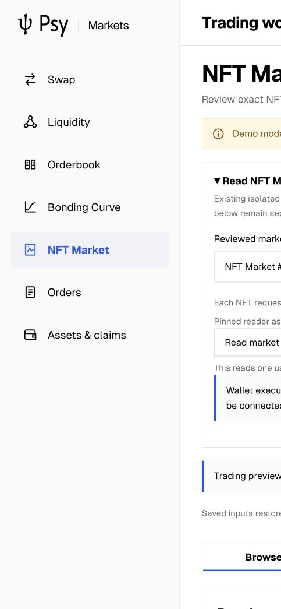
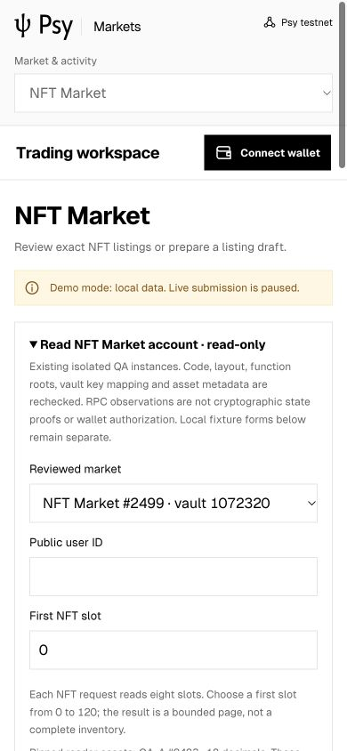

# Three-market account readers and wallet execution gap, 2026-10-27

## Outcome

This closes a public observation integration milestone, not live trading.
The formal loopback gateway, shared browser client and existing dapp now expose
pinned Orderbook, Curve and NFT Market account readers. All three actual browser
reads reached the read route and returned HTTP 503. No healthy chain state,
complete UPS, financial write, fill, fee, claim or refund was accepted. No Node,
SDK, wallet source, old contract, market semantics or financial permission changed.
The RPC heartbeat remains deleted; no background financial plan was started.

## Implemented and reviewed

- A fresh-destination registry builder matches original build hashes, ABI,
  configuration, policy and later registration evidence. It preserves the original
  false BOUND flags and records that fresh chain identity is not verified.
- Reviewed QA targets: Orderbook 2497/vault 662720, Curve 2498/vault 302272,
  NFT Market 2499/vault 1072320. QA FT 2483/2484 use 18 decimals; NFT 2499 uses
  QA-A 2483 and collection 2496. These do not assign identities to demo forms or
  update prior NFT deployments. The existing AMM registry remains byte-for-byte.
- The optional `/v1/positions` public route uses a single common checkpoint,
  exact network, code/layout/function roots, vault registration and asset metadata
  checks. Full U124 amounts, funding/settlement, native/FT pending outputs, current
  order/queue/lifecycle, Curve reserve/phase and bounded NFT slots/FIFO are decoded
  using frozen real ABIs. An inconsistent cursor or funding difference rejects.
- The browser independently checks registry, identity, complete anchors, field
  schema, precision, cursor arithmetic, freshness and bounded NFT scope. Requests
  and registry are copied before asynchronous operations. Excess ranges reject
  before HTTP. A read is RPC-observed, not a cryptographic state proof.
- Assets shortcuts only select/open/focus the reader; reads require an explicit
  action. Context changes invalidate in-flight responses and clear old data.
  Errors never substitute fixture balances. NFT pages explain eight of 128 slots
  and identify the real QA payment asset separately from the demo fixture.
- The exact user workflow explicitly binds lifecycle consumption, recovery and
  queue fields during fresh recheck, in addition to existing roots and nonce.
  This is schema-level hardening, not evidence of a proven chain exploit.

## Validation and evidence

| Check | Result | Scope |
| --- | --- | --- |
| Production build | Pass | TypeScript and Vite, final source |
| Frontend tests | 50 pass, 0 fail/skip | Existing UI/domain/persistence regression |
| Client/gateway tests | 44 pass, 0 fail/skip | Includes six new position tests and lifecycle rejection cases |
| Browser | 8 checks pass | Three actual RPC failure paths, input focus, shortcuts, mobile bounds |
| Console | No warnings/errors observed | Final tab log capture |
| Mobile | 390 x 844, no document overflow | Bounded reader and scope text |
| Desktop | 1505 x 1045 | Reader, demo separation and navigation |
| Frozen SDK | 1,466 files match | Existing selected source snapshot, not a new SDK release |
| Existing reviewed registry files | 35 match HEAD | No old registry replacement |
| Healthy chain / wallet writes | Not accepted | RPC 503 and unfinished secure provider integration |

The Browser plugin is unavailable; the existing IAB was reused through cua
Playwright after the previously recorded Ego continuity blocker. No network,
response or browser-storage injection was used. Synthetic tests use explicit test
fixtures and are not real state/UPS acceptance. Final screenshots show the reader,
not a healthy-network response. Earlier outage screenshots are preserved too.

Real gateway observations: Orderbook 13,945.6 ms, Curve 10,989.2 ms and NFT
11,873.5 ms, each HTTP 503. These are failed read durations, including bounded
checkpoint recovery, not proof, settlement, confirmation or throughput figures.
The initial Book read overlapped HMR; one browser alert wait expired before the
original response arrived. Original requests were not automatically resent.
Intermediate failures and all available logs are archived. Fees/fills/claims and
new UPS count in this run are zero; there is no acceleration or production claim.

[Immutable archive](evidence/manifest.json) contains source closure, wallet audit,
browser checks, build/test logs and RPC diagnostics. Verify with:

```sh
python3 executor/acceptance/verifyCompactArchive.py executor/verification/2026-10-27-market-readers-live-v1/evidence
```

Originals remain under `psy-market-recovery-20261023/ui-live-integration-20261027-v1`
and the sibling `ui-live-integration-20261027-v1-rpc`. The active gateway log is
preserved; only an immutable prefix is archived. No wallet recovery files, keys,
private witnesses or unsigned-plan store are included. Screenshots are separate
files whose original hashes are in the source closure.

## Open implementation and acceptance work

The wallet source audit found internal `proveEndCapProof`/`submitEndCap` and
job-level APIs. It would be wrong to say proof/submission separation is impossible.
The trace-step API can itself return `Submitted`; it is not prepare-only. Neither
inspected web provider has an accepted staged market execution protocol. Its local
wallet SDK dependency is outside the selected application snapshot; it was not
silently switched or repackaged as the selected release. Both inspected wallet
worktrees were left unchanged, including pre-existing submodule modifications.

1. **Wallet/client implementation:** add origin-approved exact preparation without
   broadcasting, independently verifiable complete UPS/public endpoints and
   source/key/circuit identity, native fresh-state/nonce/expiry/fee recheck, durable
   one-shot exact broadcast and original-identity reconciliation. Reuse reviewed
   internal primitives; do not expose an unrestricted direct-sign fallback.
2. **Gateway/Executor integration:** connect that concrete provider format to the
   existing `workflow.mjs` transport seam and independent verifier. Its test seam
   alone is not a real wallet implementation. Preserve lifecycle, calls/arguments,
   caller, session/sig_hash, fee and start/end identity constraints.
3. **Three-market financial planning:** implement actual planners and typed actions
   independently of these observation-only readers. Preserve pricing, whole-order
   matching and unique NFT settlement. No arbitrary addresses from demo forms.
4. **Operations/security evidence:** restore configured RPC; verify runtime/network
   identity and upgrade/code/layout trust as required by the original plan. A
   historical registration record or public read cannot close these boundaries.
5. **Real isolated acceptance:** fresh full preflight, ordinary wallet authorization,
   exact complete UPS, settlement, claim, refund and unknown-receipt recovery with
   actual conservation/fees and receipts. This run does not close these tests or
   the original two-pool performance and subsequent Book-to-AMM plan.

The remaining provider/planner items are unfinished implementation, not solely
external RPC dependencies. No additional financial authority follows from these
read-only changes. Do not describe the UI as fully usable for real trading yet.

Sources: [reader](../../gateway/positions.mjs),
[registry builder](../../gateway/buildPositionRegistry.py),
[client validator](../../../market-client/positionSnapshot.mjs),
[UI](../../../dapp/src/markets/MarketAccountRead.tsx),
[tests](../../gateway/positions.test.mjs),
[workflow](../../gateway/workflow.mjs).



