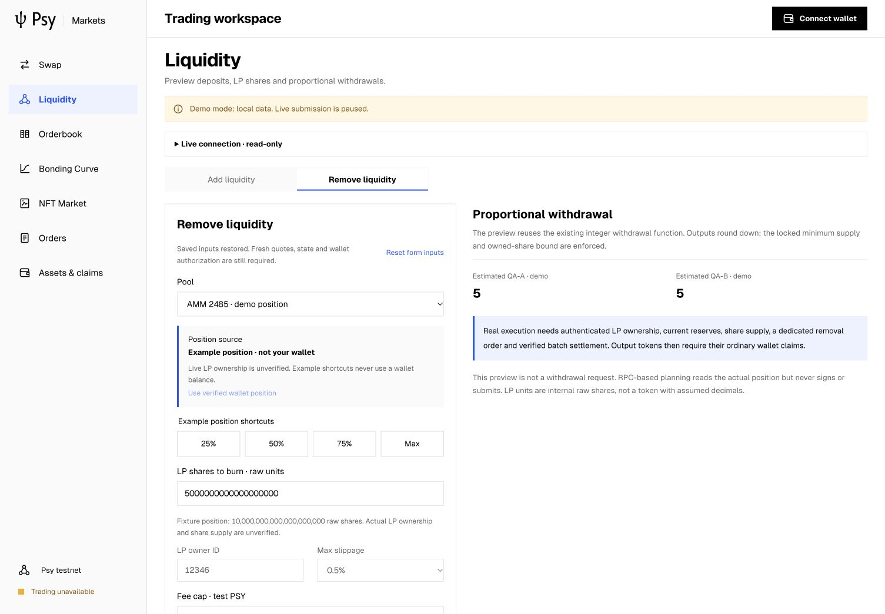
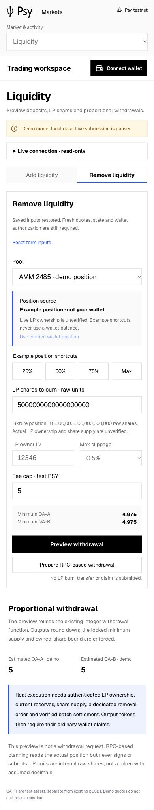
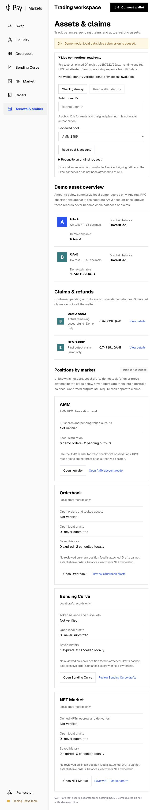

# Market usability improvements, 2026-10-27

The user authorized sequential improvements to editing persistence, liquidity
controls, field feedback and market-position presentation. The RPC heartbeat
remains deleted. No financial task or background acceptance is started.

## Phase 1: unsubmitted form persistence

Independent versioned editing records preserve Swap, liquidity add/remove/mode,
Orderbook, Curve and NFT inputs across navigation/reload. Shape, scope, version,
string length and enum allowlists are validated. Unknown fields (including nonce,
quote, balance, proof or credential fields) reject. Invalid storage preserves the
original and pauses autosave. No restored preference submits an order or becomes
a fresh quote, identity, nonce or financial authorization. Another tab's storage
change pauses writes; this is editing protection, not financial coordination.

44 frontend tests and the production build pass. Eight browser checks
confirm exact restored amounts, owner, withdrawal mode and preferences across all
market pages, including full reload and cross-tab conflict/reload recovery. Model tests cover corrupt/oversized and
wrong-scope/unsafe records; browser corruption was not injected. Later phases
will add further recovery/keyboard/mobile evidence. No keys, wallet files or
new financial operation are present. Original evidence is retained.

Sources: [editing codec](../../../dapp/src/markets/editingDrafts.mjs),
[hook](../../../dapp/src/hooks/useEditingForm.ts),
[regressions](../../../dapp/tests/editing-drafts.test.mjs).

[Phase 1 original evidence](phase1/manifest.json).

## Phase 2: liquidity editing controls

Example 1:1 deposit linking uses exact BigInt token units and rejects unknown
example pool IDs. Its independent preference survives reload. It is never used
for RPC reserves. Both maximum-wallet-balance buttons remain disabled without
verified balances. Removal explicitly selects an example position; 25/50/75/Max
shortcuts floor raw integer shares, while verified-wallet position selection
remains unavailable. No LP ownership, wallet balance or live quote is invented.

46 frontend tests and the production build pass. Five browser checks cover exact
linking, manual preference restoration, raw-share percentages and disabled live
balance/position controls. [Phase 2 evidence](phase2/manifest.json).

## Phase 3: field-specific error recovery

Shared local validation identifies amount/fee precision, positive quantities,
owner/recipient IDs, example ratios, raw shares and whole lots. Preview submits
focus the first invalid control in document order. An alert summary links to
specific controls, with aria-invalid and real description targets; correction
preserves unrelated values. Reset clears stale validation. NFT purchase/listing
settings share the same mechanism. Original preview/domain and live planning
checks remain; these usability checks are not an authoritative contract check.

49 frontend tests, production build and 11 browser checks pass, covering all six
forms, error links, exact corrected previews, reset and mobile focus/reflow.
No screen-reader conformance, live RPC/UPS or financial acceptance is inferred.
[Phase 3 evidence](phase3/manifest.json).

## Phase 4: explicit positions by market

Assets has AMM, Orderbook, Curve and NFT position cards. Data sources and local
activity are explicit; all unauthenticated holdings remain unverified/null, not
zero or inferred from a draft. Cards open the market with saved editing inputs,
or the original draft list filtered by market. Open AMM account reader opens the
readonly disclosure and focuses the public ID only, without an RPC or wallet
call. The existing real-observation panel remains separate. Actual reviewed
Book/Curve/NFT position feeds are still absent; this closes presentation and
navigation only, not real holdings/escrow or live settlement acceptance.

50 frontend tests, production build, 38 client/gateway regressions and seven
phase-4 desktop/mobile checks pass. Across four phases, 31 browser checks pass.
No relevant console warnings/errors or document horizontal overflow were observed.
Model tests confirm that missing positions remain unknown with/without drafts.
The existing IAB through cua Playwright was reused (Browser plugin unavailable;
previous Ego continuity blocker retained), with no raw Playwright process,
network/storage mock or browser-state injection. Temporary cross-tab QA used the
actual application input controls and was closed afterwards.

[Phase 4 and final source evidence](phase4/manifest.json). The immutable archive
contains the original build/test logs, browser observations, source/build hashes,
all selected screenshot hashes, language gate and final dependency checks.
Official logo and all 1,466 selected SDK source files match their existing pins.
No Node, SDK, old contract, pricing/matching or financial permission was changed.
No new RPC read, financial transaction, proof, actual fee, fill or wallet claim was
performed. The deleted heartbeat remains deleted; original financial tasks are
still pending and are not implicitly resumed by this UI work.

